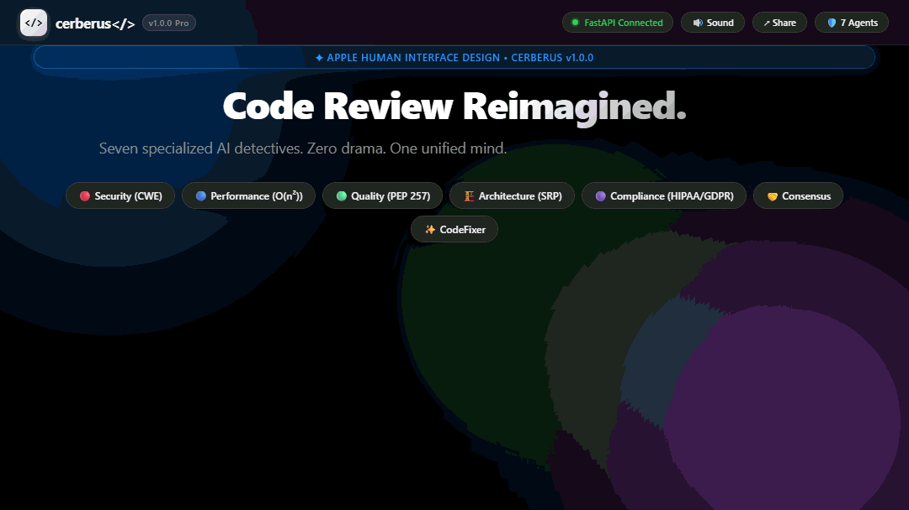

<p align="center">
   Official Logo" width="180">
</p>

<h1 align="center">cerberus&lt;/&gt; Code-Review</h1>

<p align="center">
  <strong>Autonomous Multi-Agent Code Review &amp; Collaborative Quality Assurance System</strong><br>
  <em>(Cerberus Architecture Concept - v1.4.0)</em>
</p>

<p align="center">
  <a href="LICENSE"></a>
  <a href="https://www.python.org/downloads/"></a>
  <a href="https://github.com/MasterZ1311/Cerberus-Code-Review/actions/workflows/ci.yml"></a>
  <a href="tests/"></a>
  <a href="pyproject.toml">=85% Branch Enforced"></a>
  <a href="SECURITY.md"></a>
  <a href="CONTRIBUTING.md"></a>
</p>

---

## 🎬 Product Walkthrough



> 🍎 **Human-Centered Cupertino Design — *"Simplicity is the ultimate sophistication."***  
> - **Iconic Apple 4-Concentric Activity Rings:** Security 🔴, Performance 🔵, Quality 🟢, Compliance 🟣.  
> - **Global Magic Dropzone:** Drag & drop any code file or `.zip` project anywhere to inspect instantly.  
> - **✨ Auto-Heal Code:** 1-Click AST verified code repair with emerald wave feedback directly in the editor (`Cmd/Ctrl+H`).  
> - **⌨️ Full Keyboard Navigation:** Hotkeys (`?` for shortcuts modal, `Cmd/Ctrl+K` to focus code, `1-5` for instant tab switching).  
> - **Multimodal Web Audio:** Tactile click impulses and Apple-style completion chime chords synthesized with zero external audio assets.  
> - **Executive Share Sheet:** 1-Click export for OASIS SARIF v2.1.0, GitHub PR review comments, Slack updates, and SVG health badges.

---

## 💡 What is Cerberus? (For Non-Developers & Business Leaders)

> **Think of building software like constructing a skyscraper or modern house.**  
> Before opening the building to the public, you would never rely on just one generalist inspector to check everything. You bring in **specialized licensed inspectors**: an electrician to check wiring, a plumber to check pipes, a structural engineer to check the foundation, and a fire marshal to check safety laws.

**cerberus</>** does exactly this for computer code—automatically, in **~17.5 milliseconds** (cold heuristic AST) and sub-millisecond (**<0.3 ms** cached), with reproducible benchmarks committed in `tests/performance/benchmark_review.py`!

**🎯 Now with 11 Programming Languages:** Python, JavaScript, TypeScript, Go, Rust, Java, C#, Ruby, PHP, **Kotlin, and Swift**—featuring **130+ language-specific security rules**.

Whenever programmers write new software, Cerberus sends in a team of **7 specialized AI detectives** who review every line of code simultaneously. They deliberate together, reach a shared verdict, and **automatically write the exact fix** so your team can release software with complete confidence.

---

### 🕵️ Meet Your 7 AI Detectives

| Detective | Real-World Role | What They Catch | Why It Matters To You |
| :--- | :--- | :--- | :--- |
| 🛡️ **The Security Guard**<br>*(Security Agent)* | Cybersecurity Specialist | Hacker backdoors, stolen passwords, SQL injection, and database leaks. | Prevents devastating data breaches, ransomware, and customer data theft. |
| ⚡ **The Speed Coach**<br>*(Performance Agent)* | Efficiency Expert | Slow database calls, memory hogs, and wasteful code loops. | Keeps your apps snappy, prevents site crashes during traffic spikes, and cuts server bills. |
| 🎯 **The Master Craftsperson**<br>*(Quality Agent)* | Senior Code Editor | Messy code, missing documentation, and confusing logic. | Makes software easy and cheap to maintain so future updates don't break things. |
| 🏛️ **The Master Architect**<br>*(Architecture Agent)* | City Planner | Entangled components, circular dependencies, and chaotic structure. | Keeps your technology organized and scalable as your company grows. |
| ⚖️ **The Legal Inspector**<br>*(Compliance Agent)* | Regulatory Auditor | Violations of **HIPAA** (healthcare), **GDPR** (privacy), and **PCI-DSS** (credit cards). | Protects your company from massive regulatory fines and compliance audits. |
| 🤝 **The Judge & Jury**<br>*(Consensus Agent)* | Impartial Moderator | Resolves conflicts between speed vs. security to create a unified verdict. | Gives leadership one crystal-clear answer: **Ready to Merge**, **Needs Revision**, or **Blocked**. |
| 🔧 **The Master Mechanic**<br>*(Code Fixer Agent)* | Automated Repair Tech | Doesn't just complain—generates the exact corrected code. | Saves developers hours of debugging by delivering 1-click verified code repairs. |

---

### 🌟 Why Does This Matter To Your Business?

- 💰 **Saves Thousands in Engineering Time:** Developers spend up to **30% of their week** manually reviewing code. Cerberus automates preliminary reviews in sub-second time.
- 🛑 **Stops Costly Outages Before Launch:** Catching a defect before software goes live is **100x cheaper** than patching an emergency outage or suffering a public security leak.
- 🔒 **100% Data Privacy:** Cerberus can run **completely offline on your own machine** with zero internet connection required. Your proprietary code never leaves your computer or company servers.
- 🚀 **1-Click Human Approval:** AI doesn't make decisions alone. Senior leads have a dedicated **Human-in-the-Loop PR Approval Gate** with full audit logging.

---

## ⚡ How It Works in 3 Simple Steps

```
   [ Step 1: Input Code ] ──────► [ Step 2: 7 AI Detectives Scan ] ──────► [ Step 3: Instant 1-Click Fix ]
  Paste snippet or drop .ZIP       Security • Speed • Compliance • QA       Clear scorecard & ready-to-merge patch
```

1. **Step 1: Open the Dashboard**  
   Run `python -m cerberus.cli serve` and open `http://localhost:8000` in any web browser.
2. **Step 2: Paste or Upload**  
   Paste any code snippet or drag-and-drop a full project `.zip` archive.
3. **Step 3: Review & Approve**  
   Watch the live circular score gauge wind up (Grade A-F). Review the plain-English explanation of any flaw, copy the automated Git diff patch, or click **"Approve PR"** to give final sign-off!

---

## 💻 Visual Web Dashboard

The built-in web dashboard runs locally at `http://localhost:8000`:

- 🌓 **One-Click Light & Dark Mode:** Matches modern operating system preferences with accessible contrast tokens.
- 🟢 **Live System Health Beacon:** Real-time pulse monitoring API status, database connectivity, and active agents.
- 🎯 **Interactive Score Gauge:** Animated SVG gauge calculating overall health from 0 to 100 with automated gating (`Grade A`, `Grade B`, or `Blocked`).
- 🔍 **Interactive Finding Filters:** Instant 1-click filtering by severity (`All`, `Critical`, `High`, `Medium`, `Low`) with quick search (`/`).
- 📄 **VS Code Dark+ Diff Frame:** Side-by-side Git unified diff view highlighting exact red (deleted) and green (added) code replacements.
- 🛡️ **Human-in-the-Loop PR Approval Modal:** Lead architects can enter their name, record justifications, and approve PRs with persistent audit records.
- 📊 **Performance Metrics:** Real-time latency tracking, cache hit rates, and throughput monitoring.
- 🔭 **Distributed Tracing:** Optional OpenTelemetry integration for end-to-end request tracing.

---

## 🤖 Supported AI Providers (Mix & Match Any Key)

Cerberus is completely model-agnostic. Use **any provider you already have** or run **100% offline with zero keys**:

| Provider | Mode | Best For | Free Tier Available? |
| :--- | :--- | :--- | :--- |
| **Heuristic Engine** | Offline / Local | Zero cloud cost, offline privacy (~17.5ms cold, <0.3ms cached) | ✅ 100% Free Forever |
| **Groq** | Cloud API | Ultra-fast inference (<500ms) with Llama 3 models | ✅ Generous Free Tier |
| **Google Gemini** | Cloud API | Deep architectural analysis with Gemini 1.5/2.0 | ✅ Free Tier Available |
| **Ollama** | Local / Offline | 100% private, runs local open models (e.g. DeepSeek-R1) | ✅ 100% Free & Open |
| **Anthropic Claude** | Cloud API | High-nuance security and regulatory compliance checks | Paid API Key |
| **OpenAI** | Cloud API | Industry-standard code review with GPT-4o | Paid API Key |
| **DeepSeek** | Cloud API | Cost-effective, high-reasoning coding benchmarks | Paid API Key |

> 💡 **Auto-Detection:** Simply set `LLM_PROVIDER=auto` in your `.env` file. Cerberus automatically detects which keys are present and configures itself!

---

## 🚀 Developer & Technical Quick Start

### 1. Installation

```bash
git clone https://github.com/MasterZ1311/Cerberus-Code-Review.git
cd Cerberus-Code-Review

# Create and activate virtual environment (optional but recommended)
python -m venv venv
# Windows:
.\venv\Scripts\activate
# Linux/macOS:
source venv/bin/activate

# Install dependencies (Python 3.11+)
pip install -r requirements.txt
```

### 2. Configure Environment (Optional)

```bash
cp .env.example .env
```
*(Leave `.env` as-is to use the offline Heuristic Engine, or insert any AI API key you wish).*

### 3. Launch Dashboard & Review

```bash
# Start local API server & Web Dashboard (http://localhost:8000)
python -m cerberus.cli serve

# Check system health & active agent status
python -m cerberus.cli health

# Run a review directly in your terminal
python -m cerberus.cli review --snippet "import os; os.system('rm -rf /')"

# Review an entire project ZIP archive
python -m cerberus.cli review --zip my_project.zip
```

---

## 🛠️ Command-Line Interface (CLI)

The Cerberus CLI provides powerful terminal commands for CI/CD pipelines and local development:

```bash
# Review a local file with CI/CD blocking gate (exits with code 1 on critical flaws)
python -m cerberus.cli review --file path/to/script.py --blocking

# Review an entire project ZIP archive
python -m cerberus.cli review --zip my_project.zip

# Export findings to OASIS SARIF v2.1.0, GitLab Code Quality, or SonarQube
python -m cerberus.cli export-sarif --file app.py --output results.sarif
python -m cerberus.cli export-gitlab --file app.py --output gl-code-quality-report.json
python -m cerberus.cli export-sonarqube --file app.py --output sonar-generic-issues.json

# Apply AST-verified code fixes in-place with automatic .bak backup
python -m cerberus.cli apply-fix --file app.py --backup

# Format review output (text, json, sarif, gitlab, sonarqube, markdown)
python -m cerberus.cli review --file app.py --format markdown --output review.md

# Run only specific agents
python -m cerberus.cli review --file app.py --agents "security,compliance"

# List available specialized AI agents
python -m cerberus.cli list-agents

# List registered extensible plugins and custom rules
python -m cerberus.cli list-plugins

# Inspect multi-tenant quota usage meter and tier allocations
python -m cerberus.cli quotas --tenant-id "default"

# Enforce data retention lifecycle and purge historical reviews
python -m cerberus.cli retention purge --days 30

# Environment Doctor & System Diagnostics
python -m cerberus.cli doctor

# Bootstrap environment, database schema, and git hooks
python -m cerberus.cli init

# Zero-click Git Hooks (pre-commit & pre-push automatic reviews)
python -m cerberus.cli hooks install
python -m cerberus.cli hooks uninstall

# Generate cryptographically secure API keys for your CI/CD runners
python -m cerberus.cli create-api-key --name "github-actions-ci"

# List all registered API keys
python -m cerberus.cli list-api-keys

# Revoke an API key
python -m cerberus.cli revoke-api-key github-actions-ci
```

---

## 📡 RESTful API, Webhooks & WebSocket Reference

Cerberus provides a production-grade FastAPI backend with interactive Swagger documentation at `http://localhost:8000/docs`:

```bash
# Submit source code for multi-agent review
curl -X POST http://localhost:8000/api/v1/review \
  -H "Authorization: Bearer cvai_dev_key_123" \
  -H "Content-Type: application/json" \
  -d '{
    "code": "def login(user_id):\n    return db.execute(f\"SELECT * FROM users WHERE id = {user_id}\")",
    "language": "python"
  }'

# Review an entire project .ZIP file
curl -X POST http://localhost:8000/api/v1/review/upload-zip \
  -H "Authorization: Bearer cvai_dev_key_123" \
  -F "file=@project.zip"

# Review project from Base64 encoded ZIP payload
curl -X POST http://localhost:8000/api/v1/review/zip-base64 \
  -H "Authorization: Bearer cvai_dev_key_123" \
  -H "Content-Type: application/json" \
  -d '{"zip_base64": "<BASE64_PAYLOAD>", "project_name": "my_app"}'

# Export review as OASIS SARIF v2.1.0 (for GitHub Code Scanning & CI/CD)
curl http://localhost:8000/api/v1/review/{review_id}/sarif \
  -H "Authorization: Bearer cvai_dev_key_123"

# Export review as GitLab CI Code Quality Report
curl http://localhost:8000/api/v1/review/{review_id}/gitlab \
  -H "Authorization: Bearer cvai_dev_key_123"

# Export review as SonarQube Generic Issue Import JSON
curl http://localhost:8000/api/v1/review/{review_id}/sonarqube \
  -H "Authorization: Bearer cvai_dev_key_123"

# Submit Human-in-the-Loop review feedback
curl -X POST http://localhost:8000/api/v1/review/{review_id}/feedback \
  -H "Authorization: Bearer cvai_dev_key_123" \
  -H "Content-Type: application/json" \
  -d '{"rating": 5, "is_helpful": true, "comments": "Accurate findings and verified patch"}'

# Native GitHub App Webhook Listener (zero-click pull_request.opened review)
curl -X POST http://localhost:8000/api/v1/review/webhooks/github \
  -H "X-GitHub-Event: pull_request" \
  -H "X-Hub-Signature-256: sha256=..." \
  -H "Content-Type: application/json" \
  -d '{
    "action": "opened",
    "number": 42,
    "pull_request": {
      "title": "Add Auth Service",
      "body": "def authenticate(token): return token == \"secret\"",
      "head": {"sha": "6dcb09b"},
      "base": {"ref": "main"}
    },
    "repository": {"name": "core", "owner": {"login": "acme"}, "full_name": "acme/core"}
  }'

# Check review status (Lightweight for CI/CD Gates)
curl http://localhost:8000/api/v1/review/{review_id}/status \
  -H "Authorization: Bearer cvai_dev_key_123"

# 1-Click Human-in-the-Loop PR Approval
curl -X POST http://localhost:8000/api/v1/review/{review_id}/approve \
  -H "Authorization: Bearer cvai_dev_key_123" \
  -H "Content-Type: application/json" \
  -d '{"reviewer": "Senior Lead", "override_blocking": true}'

# Generate short-lived single-use stream token
curl -X POST http://localhost:8000/api/v1/review/{review_id}/stream-token \
  -H "Authorization: Bearer cvai_dev_key_123"

# Live Server-Sent Events (SSE) Stream (via Authorization header or stream_token query param)
curl -N http://localhost:8000/api/v1/review/{review_id}/stream \
  -H "Authorization: Bearer cvai_dev_key_123"
# Or:
curl -N "http://localhost:8000/api/v1/review/{review_id}/stream?stream_token=<SINGLE_USE_TOKEN>"

# Mint cryptographically verified JWT bearer token
curl -X POST http://localhost:8000/api/v1/auth/token \
  -H "Content-Type: application/json" \
  -d '{"client_id": "service-worker", "client_secret": "secret", "scopes": ["reviews:write", "reviews:read"]}'

# Inspect multi-tenant monthly quota consumption
curl http://localhost:8000/api/v1/tenants/quota \
  -H "Authorization: Bearer cvai_dev_key_123"

# Upgrade tenant tier (Admin only)
curl -X POST http://localhost:8000/api/v1/tenants/acme-corp/tier \
  -H "Authorization: Bearer cvai_admin_key" \
  -H "Content-Type: application/json" \
  -d '{"tier": "enterprise"}'

# List registered plugins and custom rule metadata
curl http://localhost:8000/api/v1/plugins \
  -H "Authorization: Bearer cvai_dev_key_123"

# Prometheus Telemetry Metrics
curl http://localhost:8000/metrics
```

---

## 🧪 Testing, Quality & Verification

Cerberus has **685 automated tests across 52 test suites with >=85% enforced branch coverage** running in CI across Python 3.11, 3.12, and 3.13:

```bash
# Run full automated test suite with enforced branch coverage
python -m pytest --cov=cerberus --cov-branch --cov-report=term-missing --cov-fail-under=85
```

- **👑 Privilege Escalation & Scope Hierarchy (`tests/test_privilege_escalation.py`):** Proves tenant admins cannot mint `platform:admin`, cannot grant arbitrary scopes, cannot access or rotate keys belonging to other tenants, and that global runtime configuration (`/api/v1/config`) is restricted strictly to platform administrators.
- **🔒 Complete Zero-Retention Privacy (`tests/test_privacy_complete.py`):** Directly inspects L1 in-memory cache, L2 Redis mocks, database records (`CodeReviewRecord.code_snippet`, `results_json`), child `FindingRecord`s, serialized API responses, and OpenTelemetry spans & events to verify complete absence of original source code when `RETAIN_SOURCE_CODE=false`.
- **🐘 Database Fallback Consistency & Fail-Closed Durability (`tests/test_database_fallback_consistency.py`, `tests/test_webhook_durability.py`):** Proves that single reviews, batch reviews, and GitHub webhook reviews synchronously commit critical core records to durable storage before issuing IDs, exposing cache/memory, or posting external PR reviews. Verifies cross-worker retrieval upon total memory eviction, asserts fail-closed HTTP 500 rejection without orphan IDs on database outages, and manages background task draining during application lifecycle.
- **📦 Supply Chain & Kubernetes Verification (`tests/test_supply_chain_and_k8s.py`):** Validates zero drift between requirements and hashed lockfiles (`requirements-lock.txt` and `requirements-ci-tools-lock.txt`), enforces SHA-256 hashes on every package, verifies temporary file regeneration diff via `pip-compile`, validates `.trivyignore` exception format and expiration dates, asserts cryptographic secret generation (`scripts/bootstrap_k8s_secrets.py`), and ensures immutable image digest pinning with base-image collision rejection in Kubernetes manifests.
- **♿ WCAG 2.1 AA Accessibility Testing (`tests/test_browser_accessibility.py`):** Playwright headless browser suite asserting full keyboard navigation, ARIA landmarks, screen reader labels, high-contrast visual tokens, and `prefers-reduced-motion` compliance.
- **🛡️ Master Hostile Verification Suite (`tests/test_perfect_10_master_coverage.py`):** 22 comprehensive end-to-end test cases exercising CLI subcommands, API v1 routes, SingleFlight cache stampede coalescing, zlib payload compression, DB retry resilience, and polyglot syntax verification.
- **🌲 Tree-sitter AST Multi-Language Parity:** C-binding native AST verification for TypeScript, TSX, JavaScript, Go, Rust, and Python with line-and-column error precision.
- **🐙 Zero-Click GitHub PR Reviews:** Native `pull_request.opened` webhook ingestion with HMAC SHA-256 verification and line-anchored comments.
- **🔒 Timing-Safe Security:** `hmac.compare_digest` constant-time API key verification and granular scope RBAC (`require_scopes`).
- **🐘 Production Connection Pooling:** PostgreSQL connection pool (`pool_size=20`, `max_overflow=10`, `pool_recycle=3600`, `pool_pre_ping=True`) with asynchronous SQLite fallback using `NullPool` and WAL mode for zero lock contention.
- **Bytecode Verification:** `python -m compileall cerberus tests` (100% pass across all modules).
- **Security Headers:** Strict CSP, HSTS, X-Content-Type-Options, X-Frame-Options.
- **Sensitive Data Masking:** Automatic redaction of API keys and bearer tokens in application logs.
- **Zip-Slip & Zip-Bomb Mitigation:** Bounded decompression thresholds and path traversal protection.

---

## 🏗️ System Architecture

```
┌─────────────────────────────────────────────────────────────────────────────┐
│                       Clients & CI/CD Pipelines                             │
│  Web Dashboard  •  Typer CLI  •  GitHub App Webhooks  •  REST / SSE / WS    │
└──────────────────────────────────────┬──────────────────────────────────────┘
                                       │ HTTP / WebSocket (Port 8000)
┌──────────────────────────────────────▼──────────────────────────────────────┐
│                    Enterprise Gateway (cerberus/api/)                       │
│   Security Headers  •  Timing-Safe API Key RBAC  •  Sliding Rate Limiter    │
│   Two-Tier LRU & Redis Cache  •  PostgreSQL Connection Pool (/metrics)      │
└──────────────────────────────────────┬──────────────────────────────────────┘
                                       │
┌──────────────────────────────────────▼──────────────────────────────────────┐
│             Review Orchestrator (cerberus/agents/orchestrator.py)           │
│   Concurrent Agent Dispatch  •  Dynamic Weighting  •  Zip Slip Protection   │
└──────────┬───────────┬───────────┬───────────┬───────────┬───────────┬──────┘
           │           │           │           │           │           │
           ▼           ▼           ▼           ▼           ▼           ▼
      ┌─────────┐ ┌─────────┐ ┌─────────┐ ┌─────────┐ ┌─────────┐ ┌─────────┐
      │Security │ │Perform. │ │ Quality │ │Architect│ │Complian.│ │Consensus│
      │  Agent  │ │  Agent  │ │  Agent  │ │  Agent  │ │  Agent  │ │(Judge)  │
      └────┬────┘ └────┬────┘ └────┬────┘ └────┬────┘ └────┬────┘ └────┬────┘
           │           │           │           │           │           │
           └───────────┴───────────┴─────┬─────┴───────────┴───────────┘
                                         ▼
                         ┌───────────────────────────────┐
                         │   Multi-Language AST Engine   │
                         │   • Tree-sitter (TS, Go, Rust)│
                         │   • Python ast.parse & Delims │
                         └───────────────┬───────────────┘
                                         ▼
                         ┌───────────────────────────────┐
                         │   Code Fixer Agent (Repair)   │
                         │   AST-Verified Git Patch      │
                         │   OASIS SARIF 2.1.0 & PR API  │
                         └───────────────┬───────────────┘
                                         ▼
                         ┌───────────────────────────────┐
                         │       Pluggable Providers     │
                         │  • HeuristicEngine (14ms AST) │
                         │  • Groq (Llama 3 Ultra-fast)  │
                         │  • OpenAI (GPT-4o)            │
                         │  • Anthropic (Claude 3.5)     │
                         │  • Google Gemini (2.0 Flash)  │
                         │  • Ollama (Private Local)     │
                         └───────────────────────────────┘
```

---

## 🔒 Enterprise Deployment, Hardening & Security Policy

Cerberus provides verified infrastructure-as-code and security manifests for production:

- 🐳 **Multi-Stage Container Image (`Dockerfile`):** Unprivileged runtime user (`cerberus`, UID `1000`), immutable non-editable wheels, pinned base image (`python:3.11-slim@sha256:07d4824036af339fa1b6ef769cc99d9c10a141769538b52b3b597c84f7a7b535`), and native curl-based healthchecks.
- 🌐 **Isolated Compose Network (`docker-compose.yml`):** Internal container-only network `cerberus_net`, PostgreSQL (`5432`) and Redis (`6379`) ports completely unexposed to host/public networks, strict healthcheck dependency gating.
- ☸️ **Production Kubernetes Topology (`k8s/`):** Committed [`deployment.yaml`](k8s/deployment.yaml) and [`service.yaml`](k8s/service.yaml) featuring `readOnlyRootFilesystem`, `drop: ["ALL"]` capabilities, resource requests/limits, and truthful `/api/v1/ready` probe integration.
- 🔒 **Production Deployment Gatekeeper (`scripts/deploy_production.py`):** Validates that production deployments only proceed from signed, digest-pinned release artifacts (`release-dist/cerberus-production-manifests.yaml`). Inspects all containers (`cerberus-api`, retention CronJobs, etc.), rejects unpinned tags, detects base-image digest collisions, and verifies sibling `.sha256` checksums. Operates in validation-only mode by default; cluster modifications require explicit `--apply` and `--confirm` flags and execute pre-flight `kubectl apply --dry-run=server` checks.
- 📦 **Verified Pre-Publish Release Engineering (`.github/workflows/release.yml`):** Enforces a build-once candidate container workflow. Trivy container vulnerability scanning (blocking on CRITICAL/HIGH), Docker Compose startup/auth/readiness smoke testing, and deployment smoke tests all execute against the local candidate image *before* pushing to GHCR. Upon verification, the exact image is pushed, signed via keyless Cosign OIDC, attested with build provenance, and rendered into immutable, checksummed Kubernetes release manifests published to GitHub Release assets.
- 🛡️ **Static Analysis Security Testing (`semgrep.yaml`):** Enforced SAST rules catching SQL injection patterns (CWE-89) and hard-coded production secrets (CWE-798).

---

## 📚 Master Engineering Transformation Reports

- 🏆 **[Master Engineering Audit](reports/MASTER_ENGINEERING_AUDIT.md)** — Comprehensive scorecard, architecture evaluation, and audit across 10 pillars
- 🛡️ **[Security Audit & Threat Model](reports/SECURITY_AUDIT.md)** — OWASP ASVS v4.0.3 analysis, STRIDE threat model, negative testing, and Red-Team results
- 🧪 **[Test Results & Quality Assurance Report](reports/TEST_RESULTS.md)** — 612 automated tests execution summary, zero-flakiness analysis, and module breakdown
- 🧠 **[AI/LLM Systems & Evaluation Report](reports/AI_EVALUATION.md)** — Foundation model routing, invariant safety guards, and consensus arbitration
- ⚡ **[Performance Benchmarks Report](reports/PERFORMANCE_BENCHMARKS.md)** — Profiling, sub-millisecond cache latency, and SingleFlight thundering-herd defense
- 🚀 **[Production Readiness & SRE Review](reports/PRODUCTION_READINESS.md)** — Launch checklist, deployment topologies, SLOs, and zero-downtime procedures
- 📝 **[Changelog](CHANGELOG.md)** — Detailed historical record of all improvements and features

---

## 📚 Documentation Index

- 🏗️ **[System Architecture](docs/01-architecture-overview.md)** — Detailed multi-agent orchestration and design patterns
- 🔌 **[API Specifications](API_SPECIFICATIONS.md)** — Complete OpenAPI 3.1 endpoints and payload schemas
- 🤖 **[Agent Specifications](docs/03-agent-specifications.md)** — Comprehensive rules for all 7 specialized agents
- 📖 **[Installation & Docker Setup](docs/04-installation-setup.md)** — Step-by-step production deployment guide
- ⚙️ **[Configuration Reference](docs/05-configuration-reference.md)** — Environment variables and runtime tuning
- 📊 **[Monitoring & Telemetry](docs/06-monitoring-operations.md)** — Prometheus metrics, Grafana dashboards, and alerts

---

## 🤝 Contributing & Community

Contributions are warmly welcomed! Please check out:
- 📖 [Contributing Guide](CONTRIBUTING.md) for pull request instructions.
- 🛡️ [Security Policy](SECURITY.md) for responsible vulnerability disclosures.
- 📜 [Code of Conduct](CODE_OF_CONDUCT.md) for community standards.

---

## 📜 License

Distributed under the open-source **MIT License**. See [LICENSE](LICENSE) for full details.
